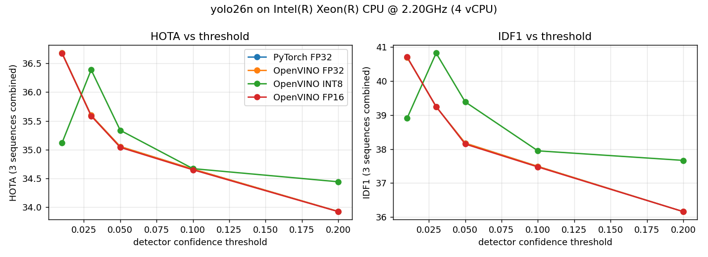

# TrackQuant-OV

Does INT8 hurt multi-object tracking? YOLO + ByteTrack on OpenVINO, measured on MOT17 with HOTA, on an Intel CPU.

Most INT8 reports for detectors give mAP and FPS. Tracking is different. A small change in box scores can break a track
and give a person a new ID. So I measured what INT8 does to the tracks, not only to the boxes.

## Results

Kaggle, Intel Xeon @ 2.20 GHz, 4 vCPU. MOT17-02, 04 and 11 combined. Each variant at its own best detector threshold.
Every number is in [`docs/RESULTS.md`](docs/RESULTS.md) with its source file.

| model | variant | HOTA | IDF1 | IDSW/min | fps (end to end) | model MB |
|---|---|---|---|---|---|---|
| YOLOv8n | PyTorch FP32 | 40.30 | 47.40 | 82.6 | 10.0 | 6.25 |
| YOLOv8n | OpenVINO FP32 | 40.30 | 47.40 | 82.6 | 13.7 | 12.3 |
| YOLOv8n | OpenVINO INT8 | **39.71** | 46.86 | 102.4 | **19.2** | 3.54 |
| YOLO26n | PyTorch FP32 | 36.68 | 40.70 | 75.5 | 13.9 | 5.29 |
| YOLO26n | OpenVINO FP32 | 36.68 | 40.70 | 75.5 | 21.7 | 9.64 |
| YOLO26n | OpenVINO INT8 | **36.38** | 40.82 | 76.9 | **28.6** | 3.21 |

- **INT8 costs little.** HOTA drops 0.59 (YOLOv8n) and 0.29 (YOLO26n). INT8 is 1.40x and 1.32x faster than OpenVINO FP32,
  and 1.9x and 2.1x faster than PyTorch.
- **OpenVINO FP32 matches PyTorch exactly.** Same tracks, same HOTA, same ID switches. For YOLO26 this needed the right export (see below).
- **Re-tune the threshold after INT8.** The best detector threshold moves after quantization.
  For YOLO26n, keeping the FP32 threshold costs 1.26 HOTA more than re-tuning it. That is bigger than the INT8 loss itself.
- **Detect every 3rd frame.** With Kalman prediction in between, INT8 runs 5.6x (YOLOv8n) and 6.0x (YOLO26n) faster than PyTorch on every frame.
  HOTA goes down 1.2 compared with INT8 on every frame.
- **ByteTrack ignores low thresholds.** Stock `bytetrack.yaml` drops every box under 0.1. Lowering the detector threshold does nothing
  until you also lower `track_low_thresh`. Doing both gave +2.0 HOTA for YOLO26n in PyTorch.



## A YOLO26 export problem

In my first run, YOLO26n on OpenVINO FP32 tracked worse than PyTorch FP32. Both got the exact same input tensor.
The default OpenVINO export (`nms=False`) already returns different boxes. On MOT17-02 at score > 0.1 only 9.8 boxes per frame match,
8.0 are PyTorch-only and 6.6 are OpenVINO-only. ID switches go from 32 to 55.
It happens at 640x640 and with dynamic shapes too.

Exporting with `nms=True` gives the same boxes as PyTorch, but the graph keeps its own 0.25 score filter and drops the low-score boxes
that ByteTrack needs. Exporting with `nms=True, conf=0.01` fixes both. Then OpenVINO FP32 and PyTorch give identical tracks.

```python
model.export(format="openvino", imgsz=[384, 640], nms=True, conf=0.01)
```

Details in [`docs/RESULTS.md`](docs/RESULTS.md), section 6, and `results/kaggle_followup/p2f_report.md`.

## Method

- **Data.** MOT17 train, FRCNN folder. Scored on MOT17-02 (static camera), MOT17-04 (crowd), MOT17-11 (moving camera).
  INT8 calibration on 300 frames of MOT17-10, which is never scored.
- **Variants.** PyTorch FP32, OpenVINO FP32, FP16 and INT8 (NNCF post-training quantization through the ultralytics export). Input 384x640 for all.
- **Tracker.** ByteTrack, stock settings, person class only, with `track_low_thresh` set to the detector threshold.
- **Sweep.** Detector threshold 0.01, 0.03, 0.05, 0.1, 0.2. Then detect every 1, 2, 3 and 5 frames at each variant's best threshold.
- **Metrics.** HOTA, DetA, AssA, MOTA, IDF1, ID switches per minute, fragments. My own implementation of the TrackEval formulas,
  checked against PyPI `trackeval` (HOTA identical to 3 decimals, same ID switch count).
- **Speed.** Pre-process, inference, post-process and ByteTrack timed separately. JPEG reading is not in the end-to-end fps.

## Repo layout

| path | what |
|---|---|
| `src/trackquant/bench.py` | The whole benchmark: MOT17 download, exports, tracking, metrics, report |
| `src/trackquant/followup.py` | The follow-up: low thresholds and the YOLO26 export check |
| `kaggle/` | One-file copies of the scripts as they ran on Kaggle (v2 = final) |
| `scripts/` | Helpers that copy `src/` into the Kaggle scripts |
| `results/` | Report, CSV, JSON and plots of every run |
| `docs/RESULTS.md` | All final tables with the source file of each number |

## Run it

```bash
pip install -r requirements.txt
python src/trackquant/bench.py --model yolov8n --track-low conf --confs 0.01,0.03,0.05,0.1,0.2
python src/trackquant/bench.py --model yolo26n --yolo26-export-nms true --track-low conf --confs 0.01,0.03,0.05,0.1,0.2
```

It downloads only the four MOT17 sequences it needs (about 0.5 GB) and writes `p2_report.md`, CSV, JSON and plots.
Add `--smoke` for a quick check on 60 frames per sequence. A full run takes about 1 to 1.6 hours on 4 vCPUs.

## Limits

- CPU only, one machine, single runs. FPS can move a few percent between runs.
- Three MOT17 sequences, person class. Not the MOT17 test server.
- Nano models only (YOLOv8n, YOLO26n).
- Peak memory is a running maximum over all variants in one process, so I do not report memory per variant.

## License

Code is AGPL-3.0, because it builds on Ultralytics (AGPL-3.0). YOLOv8 and YOLO26 weights are from Ultralytics.
MOT17 data is from [motchallenge.net](https://motchallenge.net) under its own terms and is not included here.
